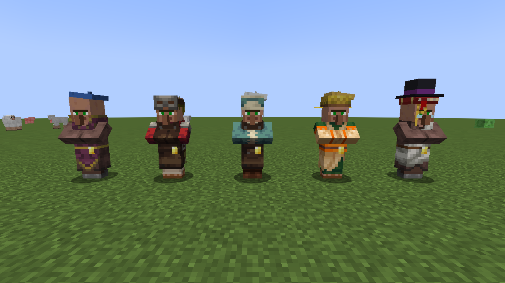
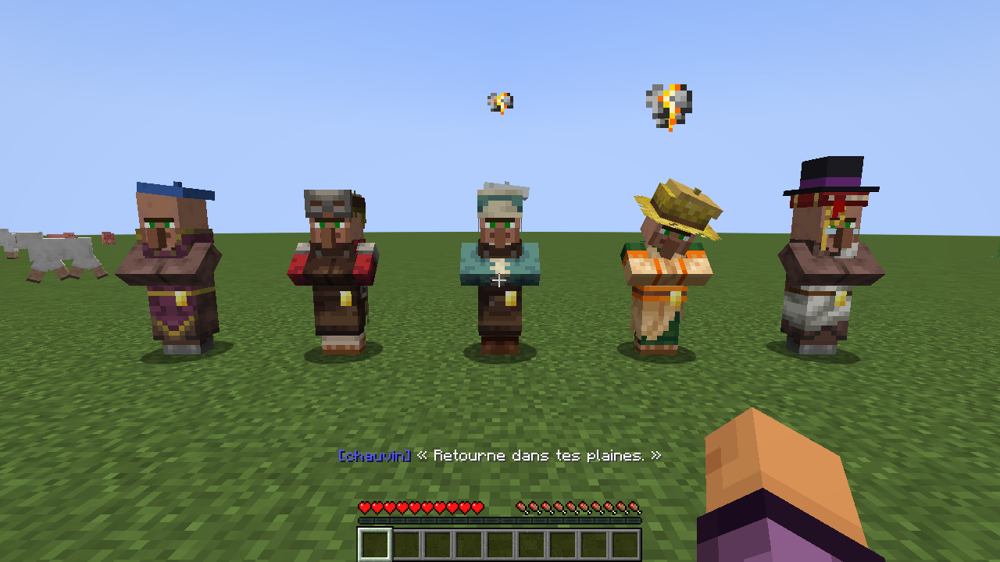
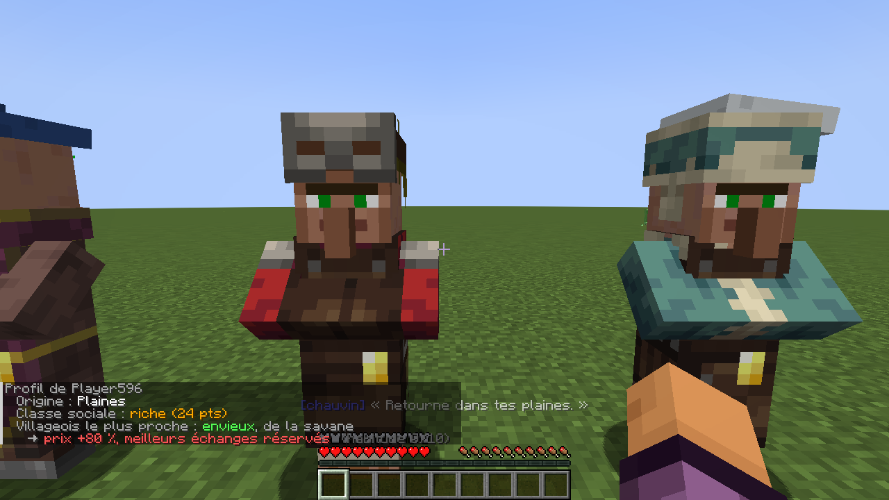
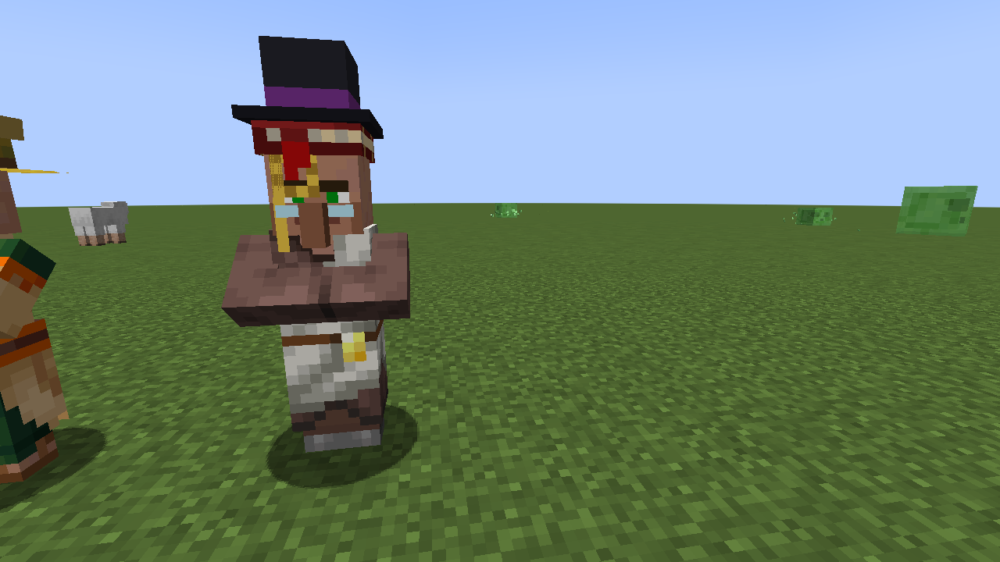

# Discrimination

Mod Fabric pour Minecraft. Les villageois ont leurs **préjugés** : ils te jugent sur ton armure, ta richesse et le biome d'où tu viens, changent leurs prix en fonction, **réservent** leurs meilleurs échanges aux « gens bien » et en **refusent** certains.



## Versions

Un jar par groupe de versions de Minecraft, chacun sur sa branche.

| Minecraft | Branche | Java | Release |
|---|---|---|---|
| 26.3 | [`26.3`](https://github.com/luuuccasss/discrimination/tree/26.3) | 25 | [1.0.0+26.3](https://github.com/luuuccasss/discrimination/releases/tag/1.0.0%2B26.3) |
| 26.1 – 26.2 | [`26.1`](https://github.com/luuuccasss/discrimination/tree/26.1) | 25 | [1.0.0+26.1](https://github.com/luuuccasss/discrimination/releases/tag/1.0.0%2B26.1) |
| 1.21.11 | [`1.21.11`](https://github.com/luuuccasss/discrimination/tree/1.21.11) | 21 | [1.0.0+1.21.11](https://github.com/luuuccasss/discrimination/releases/tag/1.0.0%2B1.21.11) |
| 1.21.6 – 1.21.8 | [`1.21.8`](https://github.com/luuuccasss/discrimination/tree/1.21.8) | 21 | [1.0.0+1.21.8](https://github.com/luuuccasss/discrimination/releases/tag/1.0.0%2B1.21.8) |
| 1.21.5 | [`1.21.5`](https://github.com/luuuccasss/discrimination/tree/1.21.5) | 21 | [1.0.0+1.21.5](https://github.com/luuuccasss/discrimination/releases/tag/1.0.0%2B1.21.5) |
| 1.21.2 – 1.21.4 | [`1.21.4`](https://github.com/luuuccasss/discrimination/tree/1.21.4) | 21 | [1.0.0+1.21.4](https://github.com/luuuccasss/discrimination/releases/tag/1.0.0%2B1.21.4) |
| 1.21 – 1.21.1 | [`1.21.1`](https://github.com/luuuccasss/discrimination/tree/1.21.1) | 21 | [1.0.0+1.21.1](https://github.com/luuuccasss/discrimination/releases/tag/1.0.0%2B1.21.1) |
| 1.20.1 – 1.20.4 | [`1.20.1`](https://github.com/luuuccasss/discrimination/tree/1.20.1) | 17 | [1.0.0+1.20.1](https://github.com/luuuccasss/discrimination/releases/tag/1.0.0%2B1.20.1) |

1.21.9 et 1.21.10 ne sont pas prises en charge.

## Ce que les villageois voient de toi

**Ton origine.** À ta première connexion, tu es recensé : tu es originaire du biome où tu es apparu (plaines, désert, neiges, taïga, savane, jungle ou marais).

**Ta classe sociale**, devinée d'après ton armure et les émeraudes que tu portes :

| Classe | Exemple |
|---|---|
| Miséreux | Pas d'armure, presque pas d'émeraudes |
| Modeste | Armure en cuir |
| Aisé | Armure en fer |
| Riche | Armure en diamant ou en netherite, ou les poches pleines d'émeraudes |

## Les préjugés

Chaque villageois tire un préjugé au hasard et le garde toute sa vie.

| Préjugé | Ce qu'il pense | Effet |
|---|---|---|
| **Snob** | Méprise les pauvres | Refuse les miséreux. Modestes : **+50 %** et meilleurs échanges réservés. Riches : **−20 %** |
| **Envieux** | Déteste les riches | Riches : **+80 %** et meilleurs échanges réservés. Aisés : **+30 %**. Miséreux : **−20 %** |
| **Chauvin** | Se méfie des étrangers à son biome | Étrangers : **+40 %**, et « Retourne dans ton désert » si en plus tu es miséreux. Gens du pays : **−20 %** |
| **Tolérant** | Rien | Prix normaux |

Un échange « réservé » coûte une pile entière d'émeraudes. Chaque fois que tu parles à un villageois, il te dit ce qu'il pense dans la barre d'action.

| Refus | `/profil` près d'un envieux, en armure de diamant |
|---|---|
|  |  |

## Dans les villages

- Les villageois qui ne t'aiment pas te **suivent du regard**, chuchotent et ferment leurs volets : « Encore un étranger… », « Mais qui a laissé entrer ce clochard ? ».
- Les **golems** d'un village suivent de près les étrangers à ce village. Contrôle d'identité.

## Se faire accepter

Les préjugés s'effacent avec l'habitude :

- chaque **échange** avec un villageois compte pour 1 ;
- **accroupi + clic droit avec une petite fleur** (coquelicot, pissenlit, tulipe…), tu lui offres un cadeau qui compte pour 2.

À partir de 3, il ne te refuse plus. À 6, il ne te réserve plus rien. À 10, il te traite comme tout le monde : « Finalement, t'es pas si mal. » Les golems laissent tranquilles ceux qui sont acceptés dans le village.

## Accessoires 3D

Avec le mod installé côté joueur, les préjugés se voient :

| Snob : haut-de-forme et monocle | Chauvin : béret aux couleurs de sa région |
|---|---|
|  | Bleu pour les plaines, sable pour le désert, blanc pour les neiges, vert pour la jungle… |

Les envieux et les tolérants n'ont pas d'accessoire. Les envieux sont discrets.

## Commande

| Commande | Effet |
|---|---|
| `/profil` | Ton origine, ta classe sociale et ce que pense le villageois le plus proche |
| `/profil <joueur>` | Le profil d'un autre joueur (op) |
| `/profil origine <joueur> <biome>` | Changer l'origine d'un joueur (op) : `plains`, `desert`, `snow`, `taiga`, `savanna`, `jungle`, `swamp` |

## Installation

1. Installer [Fabric Loader](https://fabricmc.net/use/) pour ta version de Minecraft.
2. Mettre [Fabric API](https://modrinth.com/mod/fabric-api) et le jar correspondant à ta version (voir le tableau) dans le dossier `mods/`.

Le mod s'installe **sur le serveur**. Côté joueurs, il est **facultatif** : il ajoute seulement les accessoires 3D. Il marche aussi en solo.

## Compiler

```sh
./gradlew build
```

Le jar se trouve dans `build/libs/`. Les préjugés et leurs effets se règlent dans `Prejudice.java`, les seuils de richesse dans `SocialClass.java`, l'habitude dans `Opinion.java`.
